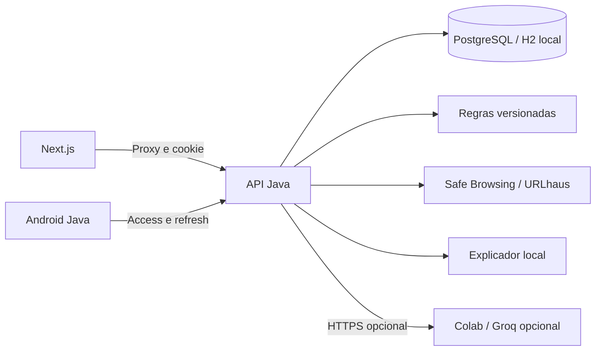

# Arquitetura implementada

Next.js/TypeScript, Java 21/Spring Boot, Android Java e notebook Python/Colab. PostgreSQL é o banco de implantação e H2 persistente facilita a apresentação local. JDBC parametrizado substituiu a proposta JPA para deixar SQL explícito e estudável. Flyway gerencia o esquema.

`UrlAnalyzer` valida, normaliza, calcula regras e remove query/fragmento. Não resolve DNS nem visita o destino; IPv6 é recusado nesta versão. `ReputationService` acessa endpoints fixos, com limites de tempo/resposta e sem redirects. `AnalysisController` persiste snapshots e aplica autorização. `AuthController` gerencia credenciais, sessões e MFA. `ChatController` recupera apenas análises autorizadas.

Indicadores e fontes ficam no snapshot JSON de `analyses.result_json`, junto aos campos indexados de proprietário, domínio, risco e data. Isso mantém score/evidências da mesma versão juntos; não é um mecanismo de analytics de grande volume.

Web: sessão de oito horas em cookie HttpOnly, proteção CSRF e token atualizado por mutação. Android: acesso de 15 minutos, refresh rotativo de sete dias e armazenamento com Android Keystore. Reutilizar refresh consumido revoga sessões. Mudar senha encerra todos os acessos.

MFA: TOTP de 30 segundos, seis dígitos, janela de um passo de cada lado e contador persistido contra replay. Segredo protegido por AES-GCM e chave de ambiente. Códigos de recuperação têm hash e uso único.

Risco: LOW 0–29, MEDIUM 30–59, HIGH 60–100. Regras: HTTP +10; IP literal +20; punycode +15; muitos subdomínios +10; URL longa +10; termos sensíveis +10; imitação de marca combinada a termos +25. Correspondência em fonte estabelece piso 80 e exibe contribuição até esse piso; soma limitada a 100. É uma heurística versionada, sem calibração estatística.

Cada fonte tem FOUND, NOT_FOUND, NOT_CONFIGURED ou UNAVAILABLE. Qualquer fonte indisponível/sem chave torna coverage=PARTIAL. A base sintética .test só existe com DEMO_MODE=true e é identificada. Não encontrar registro não comprova legitimidade.

Query/fragmento removidos reduzem exposição de tokens, mas podem reduzir correspondências. Caminho/domínio e texto livre ainda podem conter dados pessoais; isso não é anonimização. O chatbot remove URLs do histórico da pergunta, não outros dados pessoais.

O dashboard usa dados persistidos e agregação diária UTC; a interface apresenta horários locais. Métricas comerciais, clientes e eficácia não são inventados. A IA complementa a explicação determinística e não altera score ou permissões.

## Monitoramento do cliente

SiteController isola domínios por usuário, gerencia revisão/prova DNS/chave e administra assinaturas manuais. SiteMonitor usa fila limitada e duas threads; PublicSiteProbe consulta TXT e faz HEAD com IPv4 público fixado ao socket, HTTPS validado e sem redirects. V2 acrescenta sites/amostras/eventos e situação de assinatura sem apagar tabelas anteriores. Ingestão autentica chave exclusiva e deduplica UUID; contadores de simulação são separados. Não há scanner de exploração, proteção ativa ou comprovação automática de ataques. Mais detalhes em MONITORAMENTO.md.
