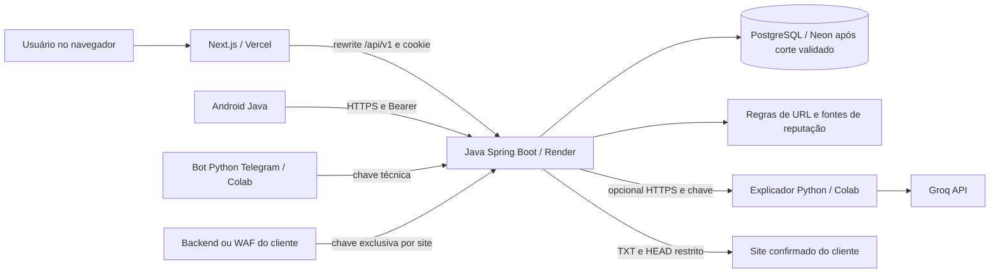

# Sentinela — contexto completo para continuidade

Documento de passagem de contexto, revisado em **04/11/2026**. Leia junto com o código e com [ESTADO-ATUAL.md](ESTADO-ATUAL.md). Este arquivo descreve o produto implementado; o estado da nuvem e as verificações têm data própria. Não contém credenciais. A apresentação do TCC está prevista para **15/12/2026**.

## 1. O que é e quais decisões foram tomadas

Sentinela é um projeto acadêmico de segurança digital com duas jornadas complementares: analisar um link enviado pelo usuário e acompanhar um site do próprio cliente. O cliente tem conta, histórico, gráficos, assistente e área de segurança. O administrador tem central separada com usuários, auditoria, sites e situação manual de assinatura.

As tecnologias foram escolhidas pelas disciplinas da faculdade: **Next.js/TypeScript** no web; **Java 21 e Spring Boot** no backend; **Android nativo em Java**, importável no Android Studio; **Python em Google Colab**, com **Groq** como provedor de linguagem. Groq é console.groq.com, diferente de Grok/xAI. Não migrar automaticamente para React Native, Node como backend, Gemini, xAI ou Neon Auth. O banco é PostgreSQL na nuvem; H2 persistente serve à execução local simplificada. JDBC parametrizado e Flyway são decisões existentes; não há JPA.

O escopo evoluiu: inicialmente era só análise pontual; depois o responsável pediu explicitamente monitoramento de sites, com e sem integração do backend do cliente. Documentos iniciais que negam monitoramento são históricos. A evolução não autoriza scanners invasivos, exploração de terceiros ou promessa de segurança absoluta.

Autores identificados nos materiais: Gustavo de Souza Rodrigues, Gabriel Herrera, Gustavo Pereira e João Eduardo Melnic. Quatro frentes de trabalho: API/banco, motor/cibersegurança, mobile e web/chatbot. Não atribuir contribuições individuais que não estejam comprovadas.

## 2. Ler primeiro e fonte de verdade

1. Este documento: objetivos, decisões, componentes e limites.
2. [ESTADO-ATUAL.md](ESTADO-ATUAL.md): recursos hospedados, data da conferência, migração e pendências.
3. [OPERACAO-COMPLETA.md](OPERACAO-COMPLETA.md): execução local, nuvem, Android, Colab e Telegram.
4. [MAPA-TECNICO.md](MAPA-TECNICO.md): arquivos, endpoints, tabelas e configuração.
5. [MIGRACAO-NEON.md](MIGRACAO-NEON.md): backup, ensaio, corte e retorno.
6. [VALIDACAO-E-TESTES.md](VALIDACAO-E-TESTES.md): comandos, resultados datados e roteiro manual.
7. Guias específicos: [MONITORAMENTO.md](MONITORAMENTO.md), [QR-CODE-2FA.md](QR-CODE-2FA.md), [GROQ-COLAB.md](GROQ-COLAB.md), [TELEGRAM.md](TELEGRAM.md).

Em divergência, conferir a implementação e o estado real antes de editar. Planos e relatórios antigos não comprovam comportamento atual. Não inventar resultados de testes, integrações ativas ou dados de clientes para preencher telas.

## 3. Arquitetura e comunicação

O browser chama `/api/v1` na mesma origem do site. `next.config.ts` reescreve para `API_INTERNAL_URL`, que inclui apenas a origem da API, sem `/api/v1`. A API tem os endpoints reais com esse prefixo. Android e Telegram usam a base da API com `/api/v1`. Não colocar senha do banco ou chave Groq em variáveis `NEXT_PUBLIC_*`.

Colab não hospeda a API Java nem o banco. Existem dois notebooks independentes: o explicador de análises e o bot Telegram. Publicar a Vercel não mantém notebooks ligados. O monitor roda dentro da API, depende de ela estar ativa e não equivale a Grafana instalado: os gráficos são componentes próprios.

## 4. Jornadas implementadas

### Conta comum

Cadastro cria sempre USER. Após entrar, a pessoa acessa Meus sites, Visão geral, Analisar link, Histórico, Assistente e Minha segurança. Pode mudar senha, revogar sessões, ativar/desativar TOTP e obter códigos de recuperação. A configuração de 2FA exige senha e confirmação do primeiro código; apenas ler o QR não conclui a ativação.

### Administração

ADMIN abre Central administrativa. O cadastro público não promove ninguém. Bootstrap com ADMIN_EMAIL ainda inexistente e ADMIN_PASSWORD de pelo menos 16 caracteres cria a primeira conta; não promove conta já cadastrada. Remover ambas as variáveis após criar. ADMIN deve ativar MFA para acessar recursos funcionais. `REQUIRE_MFA=true` estende essa exigência a todos os usuários.

Assinaturas são ACTIVE, TRIAL, PAST_DUE ou SUSPENDED. Mudar para inadimplente/suspenso bloqueia acesso e novas coletas/eventos, revogando sessões; histórico permanece. A data de vencimento é informativa, não um processamento automático de cobrança. Não há gateway de pagamento. Não confundir bloqueio com exclusão física de usuário: a API administrativa atual altera acesso/situação, sem endpoint geral de DELETE de usuário.

### Análise pontual

Recebe uma URL HTTP/HTTPS, valida e normaliza; recusa formatos perigosos e remove query/fragmento. O motor lexical **não visita o link**. Regras produzem score, risco e evidências versionadas. Fontes externas fixas podem adicionar sinal de reputação. Histórico e resultado pertencem à conta; admin tem permissões específicas no servidor.

LOW = 0–29; MEDIUM = 30–59; HIGH = 60–100. HTTP +10, IP literal +20, punycode +15, muitos subdomínios +10, URL longa +10, termos sensíveis +10, combinação de imitação de marca e termos +25. Uma correspondência positiva em fonte impõe piso 80; máximo 100. Confirmar detalhes em `UrlAnalyzer.java` antes de alterar pesos. Score é heurístico, sem calibração como probabilidade.

Cada fonte retorna FOUND, NOT_FOUND, NOT_CONFIGURED ou UNAVAILABLE. Cobertura parcial é explícita. Ausência de correspondência não prova legitimidade. `DEMO_MODE=true` inclui exemplos `.test` identificados; não utilizar isso para alegar consulta real a inteligência de ameaças.

### Monitoramento externo

Cliente cadastra nome e origem do próprio site, configura TXT `_sentinela.<domínio>` com o token mostrado e confirma propriedade. Antes de cada coleta a API verifica novamente o TXT. Consulta HEAD da raiz sem seguir redirects, com IPv4 público validado e fixado ao socket; TLS valida certificado/hostname. Não lê páginas, scripts, logs privados ou portas arbitrárias.

Coletas mostram disponibilidade por amostragem, tempo observado da conexão/resposta, vencimento de certificado e achados de cabeçalhos. O agendador consulta elegíveis a cada minuto, programa próxima coleta em aproximadamente cinco minutos, usa duas threads e fila de 20 tarefas. A interface atualiza em aproximadamente 30 segundos. API dormindo implica ausência de coletas.

Trocar protocolo/domínio cria revisão, exige nova prova e revoga chave anterior. Histórico antigo permanece associado à revisão antiga e não entra no painel atual. Alterar só nome mantém confirmação. Pausar conserva histórico.

### Eventos reais e simulados

Backend/WAF do cliente envia eventos mínimos para `/ingest/events` com `X-Sentinela-Site-Key`. A chave é gerada uma vez, armazenada como hash e só pertence ao backend do cliente. Tipos: AUTH_FAILURE, RATE_LIMIT, WAF_BLOCK, INTEGRITY_ALERT, APPLICATION_ERROR. UUID deduplica; janela de horário é de cinco minutos; `simulated` é obrigatório. Não enviar corpos de requisição, senhas ou dados pessoais.

Eventos são relatos do emissor, não ataques comprovados independentemente. Simulações ficam identificadas e separadas. Queda de site ou ausência de cabeçalho não comprova invasão ou vulnerabilidade explorável. Não existe promessa de “site 100% seguro”, bloqueio universal, proteção WAF própria ou scanner de exploração.

## 5. Autenticação e segurança

Senhas usam Argon2id. Tokens aleatórios são armazenados no banco somente por hash. Web: cookie SENTINELA_SESSION HttpOnly, SameSite Strict, oito horas, Secure em produção; mutações exigem CSRF. XSRF-TOKEN é propositalmente legível pelo cliente para enviar X-XSRF-TOKEN. Android: acesso de 15 minutos e refresh rotativo de sete dias; reutilização de refresh consumido revoga acessos. Troca de senha revoga todas as sessões.

TOTP tem seis dígitos, passo de 30 segundos, janela de um passo para cada lado e contador contra replay. QR é gerado localmente no frontend a partir de otpauth; segredo não deve ser enviado a um serviço de QR externo. Google Authenticator é compatível. Códigos de recuperação têm hash e uso único.

**ENCRYPTION_KEY precisa permanecer exatamente igual ao migrar/restaurar.** Os segredos TOTP cifrados com AES-GCM dependem dela. Um banco íntegro sem essa chave não preserva funcionamento do 2FA. Nunca gerar outra chave para resolver erro de login após migração. Backup do banco e custódia separada da chave são ambos necessários.

SQL parametrizado, autorização por proprietário/role, validação de entrada, corpo limitado a 16 KiB, limites persistidos de requisição, proteção contra replay e headers compõem a defesa. A análise pontual não navega; o monitor faz requisições externas limitadas e requer proteção específica contra SSRF. UI sem botão não substitui autorização no servidor.

Limitações conhecidas: IP visto atrás do proxy pode agrupar visitantes; CSP do web ainda permite inline; não há ensaio de carga, pentest independente, certificação ou conformidade LGPD demonstrada. Chaves, URLs e texto livre podem conter dados pessoais. Remover query não é anonimização completa. Não confiar em X-Forwarded-For arbitrário.

## 6. Chatbot, Groq, Colab e Telegram

Java escolhe dados autorizados e calcula risco. Explicação determinística permanece disponível sem IA. Com COLAB_CHAT_URL/COLAB_CHAT_KEY configurados, Java chama `/explain` do notebook. Python usa endpoint fixo `https://api.groq.com/openai/v1/chat/completions`, com GROQ_API_KEY e GROQ_MODEL explícitos; modelo precisa estar disponível na conta. Não há modelo ChatGPT escolhido implicitamente.

Saída de IA passa por validação de formato/referências; em falha há fallback. Isso reduz respostas indevidas, mas não garante verdade de cada frase. Modos/status distinguem LOCAL/COLAB e diagnóstico GROQ/OK, NOT_CONFIGURED, MODEL_NOT_SET, UNAVAILABLE_OR_INVALID. O assistente do painel de site é determinístico; não diagnostica ataques por IA.

ngrok expõe temporariamente o endpoint Colab. `NGROK_AUTHTOKEN` vem do ngrok; `COLAB_CHAT_KEY` é um segredo próprio compartilhado. A versão corrigida passa token por `PyngrokConfig` ao abrir túnel e evita regravar authtoken em arquivo existente. URL pública pode mudar após reinício; atualizar API e reiniciar quando necessário.

Bot Telegram usa `notebooks/sentinela_telegram.py`, biblioteca padrão, polling e apenas conversas privadas/IDs permitidos. TELEGRAM_BOT_TOKEN vem do BotFather; TELEGRAM_API_KEY é chave própria exclusiva que precisa coincidir no Python e na API Java; TELEGRAM_ALLOWED_USER_IDS contém IDs numéricos separados por vírgulas; SENTINELA_API_BASE inclui `/api/v1`. Identidades BOT são pseudônimas e independentes de contas humanas. Não usar senha/MFA de usuário para autenticar bot.

Não executar duas instâncias de polling com mesmo token. `/start`, `/analisar URL`, pergunta sobre análise, `/privacidade` e `/apagar CONFIRMAR` são o roteiro. A última operação apaga dados daquela identidade na API, não todas as cópias no Telegram. O upload Colab aceita nome canônico ou um único arquivo com sufixo `(1)`; múltiplos candidatos são recusados para evitar importar arquivo errado. O contexto em memória do bot se perde ao reiniciar.

## 7. Dados e manutenção

Migrações SQL V1/V2 são a fonte do esquema; não editá-las depois de aplicadas para fazer uma atualização. Criar V3 e testes em banco isolado se houver evolução. Snapshots JSON guardam evidências junto ao resultado. Instantes de domínio são em milissegundos epoch; agregações diárias usam UTC, UI mostra hora local. Não trocar unidades silenciosamente.

Banco tem informações de contas, tokens com hash, MFA cifrado, análises, conversas, auditoria, rate limiting, sites, amostras e eventos. Consulte o mapa de dados para relacionamentos. Não versionar dumps, H2 `data/`, `.env`, `.runtime`, tokens, chaves, keystore ou `local.properties`. Logs de testes podem conter dados sintéticos; revisar antes de publicar.

Rotinas de limpeza em `scripts/manutencao.sql` são exemplos e não estão agendadas automaticamente. Não há política completa de retenção automatizada nem restauração ensaiada continuamente. Exclusão de análise remove conversas vinculadas no fluxo da API. Não rodar scripts destrutivos em produção como se fossem testes.

## 8. O que outra IA deve fazer ao assumir

Receber este repositório, ler a documentação acima e conferir branch/commit/status local e remoto antes de alterar. Identificar ambiente H2 local, PostgreSQL de testes e produção: não rodar a suíte contra produção. Consultar estado atual dos provedores, não assumir que IDs, plano, cotas ou URLs continuam válidos.

Manter escolhas acadêmicas e arquitetura existente, corrigir causas com testes proporcionais, registrar alteração e evidência. Nunca inferir que todas as integrações estão configuradas porque existem variáveis no exemplo. Pedir credenciais pelo fluxo privado do provedor ou entrada local protegida, nunca no chat ou em commit. Segredos não são parte do contexto a compartilhar com outra IA.

Para mudanças externas autorizadas, preparar e validar antes do corte. Se não houver acesso seguro, declarar o bloqueio sem trocar para banco vazio. Não excluir a origem para “limpar”, não pagar plano sem autorização e não desativar 2FA/CSRF/TLS para fazer demonstração funcionar.

Uma boa entrega registra o que mudou, comandos executados, resultado observado e o que ainda depende de teste humano (Google Authenticator físico, Android real, Groq/Telegram e domínio DNS próprios). “Tudo testado” informado pelo responsável é evidência do relato dele, não prova de que o agente executou esses testes.

## 9. Texto de transferência para outra IA

> Você está continuando o projeto acadêmico Sentinela. Leia docs/CONTEXTO-COMPLETO.md, docs/ESTADO-ATUAL.md, docs/MAPA-TECNICO.md e docs/OPERACAO-COMPLETA.md antes de alterar. Preserve Next.js, Java/Spring Boot/JDBC/Flyway, Android Java e Python Colab/Groq. Existem análise pontual de URL e monitoramento de domínio com confirmação TXT; não prometa detecção de invasão por URL. A pontuação vem do Java. ADMIN tem 2FA obrigatório e USER opcional salvo REQUIRE_MFA=true. Preserve ENCRYPTION_KEY e os dados. Não use produção para testes destrutivos nem inclua segredos no contexto ou Git. Confirme estado/commit, leia o relatório de migração e execute validação proporcional às mudanças. A apresentação está prevista para 15/12/2026. Informe claramente testes reais, simulados e pendências.
